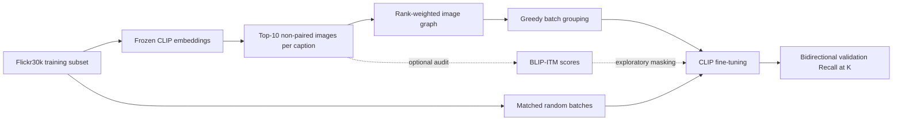

# CLIP-Hard-Negative-Retrieval

CLIP-based image-text retrieval with hard negative mining, GRIT-inspired batch grouping, and contrastive learning.

## Project Overview

Random mini-batches rarely place a query beside its hardest retrieval candidates. This project fine-tunes **CLIP ViT-B/32** on Flickr30k and uses an offline similarity graph to group related images into batches. A matched random-batch control isolates the effect of batch composition across three seeds. BLIP image-text matching provides an exploratory analysis of potential false negatives.

## Highlights

- **79.97% bidirectional mean Recall@1**, with **72.63% T2I** and **87.31% I2T**, averaged across seeds 42, 123 and 2026.
- **+1.36 ± 0.27 percentage points** over matched random batches (mean ± sample SD of paired gains).
- Queries sharing a batch with at least one mined Top-10 candidate increase from **2.70% to 72.24%** in the seed-42, epoch-1 diagnostic.
- Controlled comparisons use identical initial weights, per-image caption choices, training settings and validation protocol.

## Method



1. Encode 5,000 training images and their 25,000 captions with pretrained CLIP; normalize the 512-dimensional features.
2. For each caption, mine the ten highest-cosine images excluding its annotated source image: 250,000 candidate relations.
3. Build an undirected image graph with rank weight `(K + 1 - rank) / K`. Starting from a seeded random image, greedily add unused images with the greatest summed affinity to the current batch.
4. Train both CLIP encoders with symmetric image-to-text and text-to-image cross-entropy. Each image appears once per epoch with one of its five positive captions; caption choices are shared between the two sampling arms.

The graph is computed once from frozen features. Epoch-specific batch plans are prepared offline; this is a **GRIT-inspired static grouping implementation**.

## Experimental Results

Training uses a fixed seed-42 subset of **5,000 images / 25,000 captions**. Both arms use batch size 16, AdamW, learning rate `1e-6`, weight decay `0.01`, FP16 AMP and 10 epochs. The data subset stays fixed when the training/grouping seed changes.

All values below are percentages. Mean R@1 is the arithmetic mean of T2I and I2T R@1.

| Seed | Random T2I R@1 | Random I2T R@1 | Random mean R@1 | GRIT T2I R@1 | GRIT I2T R@1 | GRIT mean R@1 | Gain (pp) |
| --- | ---: | ---: | ---: | ---: | ---: | ---: | ---: |
| 42 | 71.56 | 85.70 | 78.63 | 72.50 | 87.57 | 80.04 | +1.41 |
| 123 | 71.20 | 86.19 | 78.70 | 72.15 | 87.38 | 79.76 | +1.07 |
| 2026 | 70.93 | 86.09 | 78.51 | 73.23 | 86.98 | 80.11 | +1.60 |
| **Mean** | **71.23** | **86.00** | **78.61** | **72.63** | **87.31** | **79.97** | **+1.36** |

**Evaluation protocol.** Use the complete `AnyModal/flickr30k` validation split: 1,014 images and 5,070 captions. T2I succeeds when the caption's source image appears in the top K; I2T succeeds when any of the image's five captions appears in the top K. Each run selects its best epoch by the sum of validation T2I and I2T R@1.

**Evidence.** [Per-seed results](outputs/d7/seed_summary.csv), the six runs' `config.json`, `history.json` and `best/metrics.json`, and all three seeds' batch plans and quality CSVs are retained in [outputs/d7](outputs/d7). The coverage highlight comes from [seed-42 batch quality](outputs/d7/grit_batches/batch_quality.csv), epoch 1; it measures batch composition using frozen features, independently of retrieval Recall@1. Recalculate the paired summary without model weights or third-party packages:

```bash
python summarize_grit_seeds.py
```

Synthetic CPU regression checks (no data or weights required):

```bash
python -m unittest discover -s tests -v
```

## Project Structure

| Path | Purpose |
| --- | --- |
| `src/13_make_train_subset.py`, `src/14_extract_train_embedding.py` | Fixed subset selection and frozen CLIP features |
| `src/17_mine_top10.py`, `src/18_score_top10_caption_risk.py` | Top-K mining and optional caption-overlap risk diagnostics |
| `src/19_train_clip_baseline.py` | Standalone random-caption fine-tuning baseline |
| `src/20_build_grit_batches.py`, `src/21_train_clip_grouped.py` | Batch plans, quality diagnostics and matched training |
| `src/06_prepare_val.py`, `src/07_eval_val.py` | Validation gallery export and checkpoint evaluation |
| `src/22_score_blip_itm_audit.py`, `src/23_train_grit_blip_mask.py` | Optional BLIP audit scoring and loss masking |
| `run_grit_more_seeds.sh`, `summarize_grit_seeds.py` | Three-seed paired runs and result aggregation |
| `outputs/` | Original lightweight experiment evidence; no model weights |

## Getting Started

### Environment and data

Use Python 3.10–3.12. Training requires an NVIDIA CUDA GPU; mining, grouping and result aggregation can run on CPU. The commands below use a Bash shell from the repository root.

```bash
git clone https://github.com/wxl829/CLIP-Hard-Negative-Retrieval.git
cd CLIP-Hard-Negative-Retrieval
python -m venv .venv
source .venv/bin/activate
# Example CUDA 12.4 build; choose a build compatible with your driver.
python -m pip install torch==2.6.0 --index-url https://download.pytorch.org/whl/cu124
python -m pip install -r requirements.txt
```

For CPU checks, install PyTorch from `https://download.pytorch.org/whl/cpu` instead. [PyTorch installation options](https://pytorch.org/get-started/locally/) cover other platforms.

The scripts load the [AnyModal Flickr30k packaging](https://huggingface.co/datasets/AnyModal/flickr30k) through Hugging Face Datasets. Consult the [original Flickr30k project](https://shannon.cs.illinois.edu/DenotationGraph/) and obtain authorized dataset access under its terms. Images and captions are downloaded locally and are not redistributed here.

CLIP weights come from [openai/clip-vit-base-patch32](https://huggingface.co/openai/clip-vit-base-patch32). The code pins the safetensors revision `be35e1cf6ab51bb4daa2b1db53e9f543d4544b47`, resolved from the original experiment's `refs/pr/40`. Optional BLIP weights come from [Salesforce/blip-itm-base-coco](https://huggingface.co/Salesforce/blip-itm-base-coco). Model and dataset downloads require network access on the first run; standard Hugging Face cache settings apply.

### Prepare features and candidate relations

```bash
python src/13_make_train_subset.py
python src/14_extract_train_embedding.py
python src/17_mine_top10.py --top-k 10
```

These produce `outputs/d5/train_subset/train_subset.json`, `outputs/d5/embeddings/{metadata.json,image_embeds.pt,text_embeds.pt}` and `outputs/d5/hard_negative/hard_negative_top10.jsonl`. Subset indices, caption order and dataset row order must remain aligned. The published batch plans contain indices only; regenerate metadata and features before using them.

### Train paired experiments

Run all six matched experiments into a fresh, ignored directory, leaving the published records intact:

```bash
GPU_ID=0 bash run_grit_more_seeds.sh
```

The runner builds 10-epoch plans for seeds 42, 123 and 2026, trains both arms and summarizes `outputs/reproduced/d7`. Existing training directories cause an explicit stop. For an individual run:

```bash
python src/20_build_grit_batches.py --epochs 10 --seed 42 \
  --output-dir outputs/reproduced/groups42
CUDA_VISIBLE_DEVICES=0 python src/21_train_clip_grouped.py \
  --group-file outputs/reproduced/groups42/grouped_batches.json \
  --sampler grit --seed 42 --epochs 10 --batch-size 16 --lr 1e-6 \
  --output outputs/reproduced/grit42
```

Use `--sampler random` with the same group file and seed, and a distinct output directory, for the matched control. `src/19_train_clip_baseline.py` is an earlier standalone baseline; the results table uses the matched trainer above.

### Evaluate a saved checkpoint

Training evaluates the validation split after every epoch. For separate evaluation of a locally trained checkpoint:

```bash
python src/06_prepare_val.py
python src/07_eval_val.py --model-path outputs/reproduced/grit42/best \
  --output outputs/reproduced/eval_grit42
```

The export writes lossless PNGs and retains all five captions per image. Omit `--model-path` to evaluate pretrained CLIP. Checkpoints are generated by training and are excluded from Git.

## Limitations & References

- Results are best-checkpoint **validation** results, not standard Flickr30k test-set results or SOTA claims. Three paired seeds quantify observed variation, not statistical significance. The original training environment and dataset revision were not recorded; release dependency pins support code validation rather than guaranteeing identical training outcomes.
- Static grouping does not refresh neighbors as CLIP changes and is not a full GRIT-VLP reproduction.
- BLIP-ITM masking remains exploratory, with no clear additional retrieval gain. Retained D8 records describe the existing ablation. The case-level audit inputs are not included; scoring/masking require locally prepared cases and scores with the schemas checked by scripts 22/23. Codex-assisted audit labels are not human ground truth.
- Local release checks cover syntax, experiment-record consistency and synthetic CPU behavior. GPU training and full dataset/model evaluation were not rerun for this release.

References: [CLIP (Radford et al., 2021)](https://arxiv.org/abs/2103.00020) · [GRIT-VLP (Byun et al., 2022)](https://arxiv.org/abs/2208.04060) · [BLIP (Li et al., 2022)](https://arxiv.org/abs/2201.12086) · [Flickr30k (Young et al., 2014)](https://shannon.cs.illinois.edu/DenotationGraph/).
